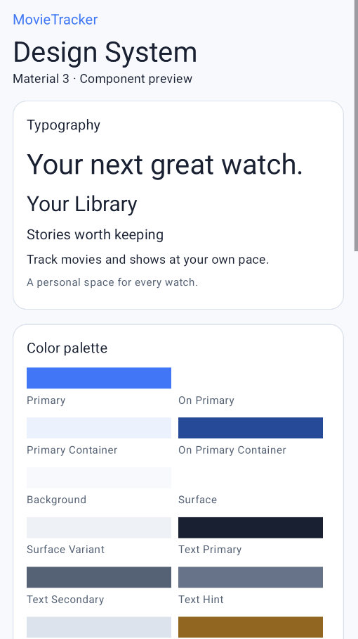
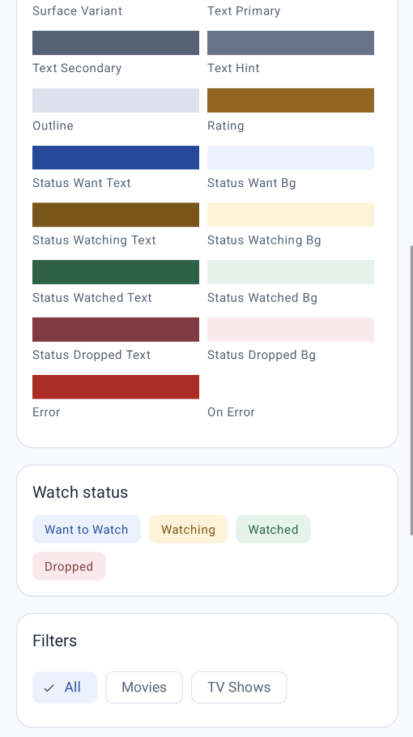
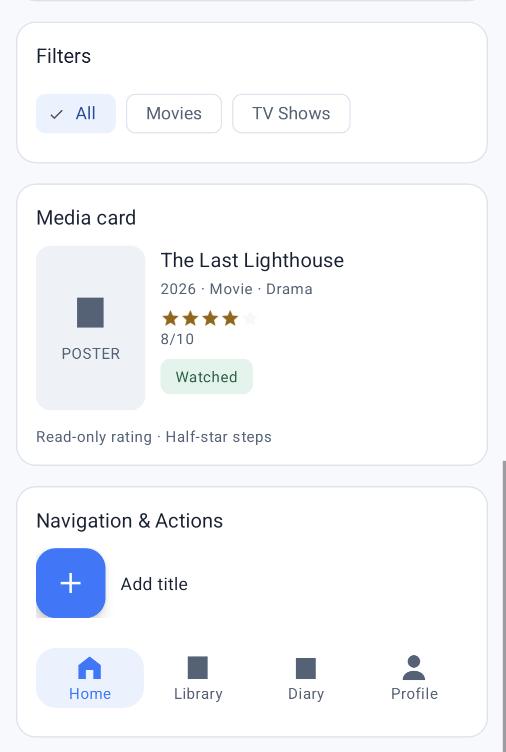
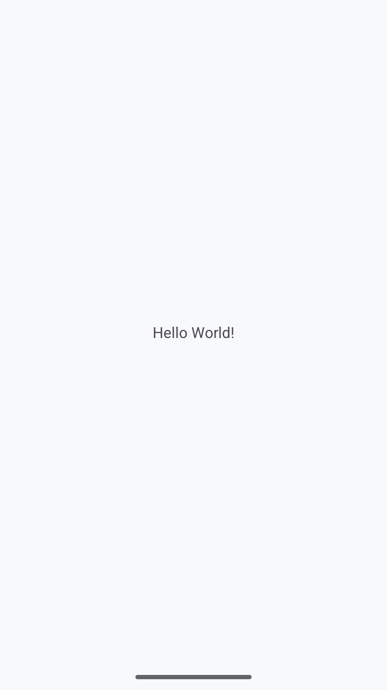

# MovieTracker Design System

UI-1 · English interface · Material Design 3 · light only

## Usage

Use `Theme.Group6androidappdev`. All interface copy belongs in `strings.xml`. Keep Java, navigation, Gradle and Manifest unchanged for UI-1. This design reuses the existing UI foundation blue (#2979FF), pale background (#F7F9FC) and white surfaces. Material 3 is the [component baseline](https://m3.material.io/).

## Colors

| Resource | Value | Use |
| --- | --- | --- |
| `primary` | `#2979FF` | Brand accents, primary actions and selected navigation icons/labels; use on_primary for content on a solid primary fill |
| `on_primary` | `#FFFFFF` | Text and icons on a solid primary fill, including the primary FAB |
| `primary_container` | `#EAF2FF` | Pale selected-filter and highlighted-container background |
| `on_primary_container` | `#174B9C` | Readable text/icons on primary_container, including selected filter labels |
| `background` | `#F7F9FC` | Full-page background behind cards |
| `surface` | `#FFFFFF` | Card and bottom-navigation background; unselected filter background |
| `surface_variant` | `#EDF1F7` | Secondary filled regions such as poster placeholders |
| `text_primary` | `#172033` | Headings, media titles and body content |
| `text_secondary` | `#526176` | Supporting information such as year, type, genre and captions; unselected navigation labels/icons |
| `text_hint` | `#64748B` | Input hints and placeholder guidance, rather than primary content |
| `outline` | `#DCE3ED` | Dividers, card outlines and unfilled rating-star background |
| `rating` | `#986400` | Filled stars in read-only ratings |
| `status_want_text` | `#174B9C` | Want to Watch badge text; pair with status_want_bg |
| `status_want_bg` | `#EAF2FF` | Want to Watch badge background; pair with status_want_text |
| `status_watching_text` | `#805400` | Watching badge text; pair with status_watching_bg |
| `status_watching_bg` | `#FFF3D6` | Watching badge background; pair with status_watching_text |
| `status_watched_text` | `#176245` | Watched badge text; pair with status_watched_bg |
| `status_watched_bg` | `#E0F4EA` | Watched badge background; pair with status_watched_text |
| `status_dropped_text` | `#8A3441` | Dropped badge text; pair with status_dropped_bg |
| `status_dropped_bg` | `#FCE8EC` | Dropped badge background; pair with status_dropped_text |
| `error` | `#BA1A1A` | Error messages and error accents; pair with on_error on a solid error fill |
| `on_error` | `#FFFFFF` | Text/icons on a solid error fill |

Use each `status_*_text` with its matching `status_*_bg`; status labels must remain visible so color is never the only signal. The retained brand blue is used for accents; small selected text uses the darker `on_primary_container`.

## Dimensions

| Resource | Value | Use |
| --- | --- | --- |
| `text_headline` | `32sp` | Large heading at the top of a screen; avoid repeating inside ordinary cards |
| `text_title` | `24sp` | Page heading or major section heading |
| `text_card_title` | `16sp` | Media title, card heading or compact section heading |
| `text_body` | `14sp` | Body copy and ordinary labels |
| `text_caption` | `12sp` | Year/type/genre metadata and supporting descriptions |
| `space_4` | `4dp` | Tightly related text, such as media title to year/type/genre |
| `space_8` | `8dp` | Icon-to-label gaps and related elements within one group |
| `space_12` | `12dp` | Poster-to-details gap and horizontal padding inside badges |
| `space_16` | `16dp` | Default screen inset, card padding and spacing between adjacent cards |
| `space_24` | `24dp` | Separation between major content sections, such as Continue Watching and Recent Records |
| `corner_card` | `16dp` | Corner radius for shared media/content cards |
| `corner_badge` | `8dp` | Corner radius for the four watch-status badge backgrounds |
| `corner_button` | `12dp` | Button shape corner radius; apply ShapeAppearance.Group6.Button explicitly |
| `badge_horizontal_padding` | `12dp` | Start/end padding inside each status badge |
| `badge_vertical_padding` | `6dp` | Top/bottom padding inside each status badge |
| `poster_width` | `88dp` | Width of the compact sample media-card poster; adapt for other card formats |
| `poster_height` | `132dp` | Height of the compact sample media-card poster; adapt for other card formats |
| `touch_target` | `48dp` | Minimum interactive target |
| `swatch_width` | `32dp` | Palette-preview swatch and sample poster-icon size |
| `icon_size` | `24dp` | Navigation illustration icon size |
| `card_outline_width` | `1dp` | Card outline thickness |

Use 16dp screen padding and the 4/8/12/16/24dp spacing scale. These are the default conventions for new screens; the sample palette grid may use the same dimensions for compact preview arrangement. Keep repeated relationships consistent across pages rather than choosing a different gap for each item. Cards have 16dp corners, badges 8dp and buttons 12dp. Button shapes can use `ShapeAppearance.Group6.Button`. Use wrap-content for English labels and keep interactive touch targets at least 48dp.

## Styles

| Resource | Use |
| --- | --- | --- |
| `TextAppearance.Group6.Headline` | 32sp large display heading |
| `TextAppearance.Group6.Title` | 24sp page heading |
| `TextAppearance.Group6.CardTitle` | 16sp card or section heading |
| `TextAppearance.Group6.Body` | 14sp body copy |
| `TextAppearance.Group6.Caption` | 12sp supporting copy |
| `Widget.Group6.Card` | Outlined Material 3 card on white surface |
| `Widget.Group6.StatusBadge` | Base badge; use a state variant |
| `Widget.Group6.StatusBadge.Want` | Want to Watch status |
| `Widget.Group6.StatusBadge.Watching` | Watching status |
| `Widget.Group6.StatusBadge.Watched` | Watched status |
| `Widget.Group6.StatusBadge.Dropped` | Dropped status |
| `Widget.Group6.FilterChip` | Checkable filter; checked container and text change together |
| `Widget.Group6.RatingBar.Small` | Read-only five-star rating, half-star steps |
| `Widget.Group6.BottomNavigation` | Primary selected icon/label; gray unselected items |
| `Widget.Group6.Fab` | Primary add action |
| `ShapeAppearance.Group6.Button` | 12dp button shape override |

## Rating and text

Ratings use 0–10 in product data and 0–5 stars in the small RatingBar: set the displayed rating to score / 2. A score of 8/10 displays four stars. A null score means not rated: show localized Not rated text and hide the star/score display instead of converting null to zero. A numeric zero remains a valid rating. Override the rating content description for each item using a formatted string. Do not reuse the sample description for production data. No editable rating behavior is delivered in UI-1.

Do not display the implementation note “Read-only rating · Half-star steps” on media cards or in the component sample. Show only the stars and score. This behavior is documented here for developers.

The interface uses system typography, English labels and no downloaded font. Labels: Want to Watch, Watching, Watched, Dropped. Date examples should use an English locale. The fictional sample movie and placeholder poster are original content.

## Preview and scope

Open `app/src/main/res/layout/design_sample.xml` in Android Studio Split or Design. The preview declares the application theme. It includes all five text levels, palette swatches, four badges, selected/unselected filter chips, a read-only rating, fictional media card and FAB.

UI-1 acceptance decision (November 5, 2026): retain the four static navigation placeholders and the reusable `Widget.Group6.BottomNavigation` style. The user explicitly assigned the real navigation component and its interaction to G1 acceptance. The hidden, menu-less BottomNavigationView in the sample is not evidence of a working navigation component. No res/menu resources, Java or app navigation changes are included in UI-1.

G1 must apply this style to a visible BottomNavigationView with Home, Library, Diary and Profile items and connect them to the four Fragments defined in docs/architecture.md. G1 acceptance must verify that every tab opens its page, selected icons/labels use primary, unselected items use text_secondary, and the selected tab remains consistent with the displayed page after state restoration. These checks are pending G1 work; the static UI-1 screenshot does not satisfy them.

## Verification

See `validation.md` for build results and remaining manual checks. Android Studio preview screenshots and emulator screenshots must be captured from actual rendering; they must not be replaced with a mockup.

## Final component preview screenshots

User-provided final screenshots captured on November 5, 2026 at 20:36–20:37 (Asia/Hong_Kong). These show successive, overlapping sections of the scrollable `design_sample.xml` page in the authorized local AGP 9.3.0 preview copy. The formal deliverable retains AGP 9.4.1 and the original Gradle configuration. Original screenshot pixels are preserved. These screenshots precede removal of the “Read-only rating · Half-star steps” caption; the current layout omits that caption as requested.

### 1. Typography and brand colors



### 2. Semantic colors, watch status badges and filters



### 3. Media card, read-only rating, floating action button and navigation illustration



## App runtime evidence



This verifies app startup only. It is not a screenshot of the component sample page.

## Component usage examples

Apply text styles through `android:textAppearance`; apply widget styles through `style`. Use `@color/text_hint` for hints, `@color/text_secondary` for supporting information, `@color/outline` for dividers/outlines and `@color/rating` for rating stars. Pair `primary_container` with `on_primary_container` for selected containers. Use `surface_variant` for poster placeholders, `surface` for cards and `background` for the screen.

```xml
<TextView
    android:layout_width="wrap_content"
    android:layout_height="wrap_content"
    android:text="@string/status_watching"
    style="@style/Widget.Group6.StatusBadge.Watching" />
```

```xml
<com.google.android.material.chip.Chip
    android:layout_width="wrap_content"
    android:layout_height="wrap_content"
    android:text="@string/sample_movie"
    android:checked="true"
    style="@style/Widget.Group6.FilterChip" />
```

### Text and card

```xml
<com.google.android.material.card.MaterialCardView
    xmlns:android="http://schemas.android.com/apk/res/android"
    style="@style/Widget.Group6.Card"
    android:layout_width="match_parent"
    android:layout_height="wrap_content">
    <TextView
        android:layout_width="match_parent"
        android:layout_height="wrap_content"
        android:padding="@dimen/space_16"
        android:text="@string/sample_film"
        android:textAppearance="@style/TextAppearance.Group6.CardTitle" />
</com.google.android.material.card.MaterialCardView>
```

### Read-only rating

```xml
<RatingBar
    xmlns:android="http://schemas.android.com/apk/res/android"
    style="@style/Widget.Group6.RatingBar.Small"
    android:layout_width="wrap_content"
    android:layout_height="wrap_content"
    android:rating="4"
    android:contentDescription="@string/sample_rating_description" />
```

This fixed sample represents 8/10. Production code supplies the actual score divided by two and a matching localized content description. Keep rating editing in the later feature work.

### Bottom navigation integration contract for G1

Apply `style="@style/Widget.Group6.BottomNavigation"` to the real `com.google.android.material.bottomnavigation.BottomNavigationView`. G1 supplies its menu resource and Fragment switching. The style supplies selected/unselected colors and labeled items; it does not create menu items or navigation behavior. Do not copy the sample's `android:visibility="gone"` into the app shell. No runnable navigation example is claimed in UI-1.

For production cards, supply a per-item rating content description in the layout or binding. The reusable rating style deliberately contains no sample-specific accessible label. `AppCompatImageView` is used when `app:srcCompat` and `app:tint` are needed.

## Local preview environment

The installed Android Studio Quail 3 (2026.1.3) rejects this project's AGP 9.4.1 during sync because it supports through 9.3.0. The user authorized an independent local preview copy using AGP 9.3.0. That copy is for visual verification only; the deliverable retains the project's original AGP and Gradle files. Screenshot captions must identify the preview environment.
