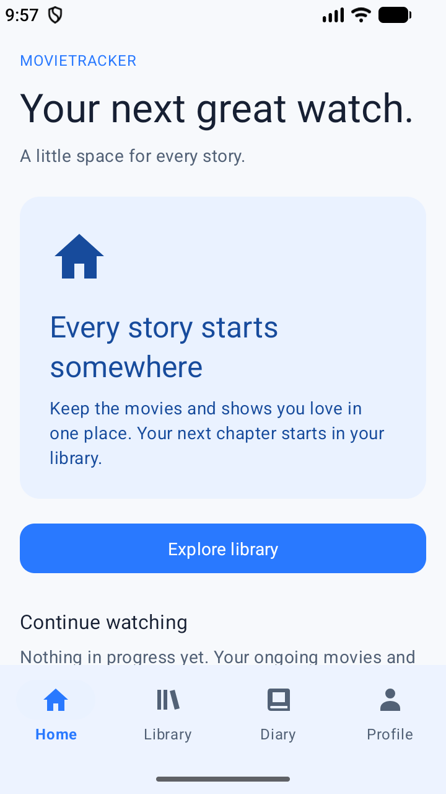
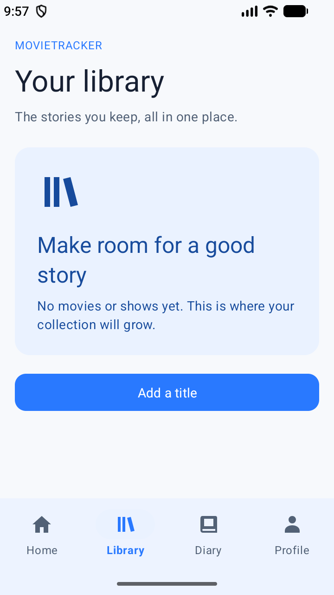
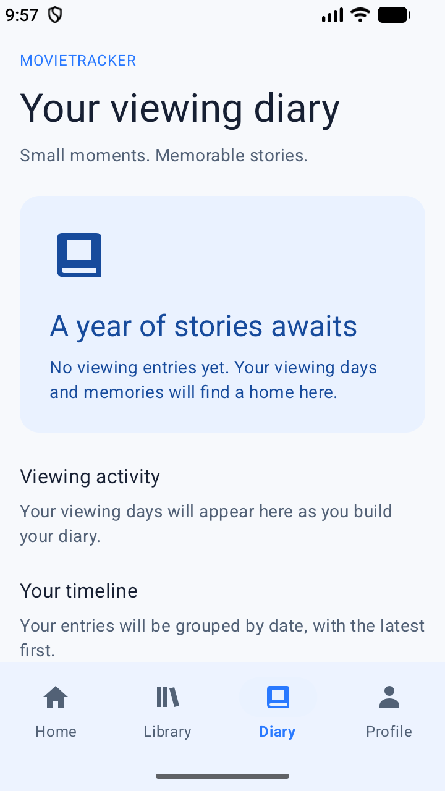
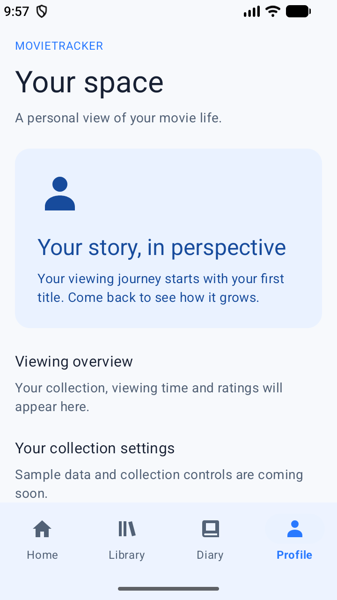

# G1 — App shell

## Scope

Built directly on UI-1 commit `f727f93`; no old UI branch code is imported. The UI-1 sample stays unchanged. G1 delivers a visible Material bottom navigation and four independent page shells: Home, Library, Diary and Profile. All use the UI-1 semantic colors, five-level typography and spacing resources. Widget.Group6.BottomNavigation.Shell extends the UI-1 navigation style to explicitly bind its active indicator, surface fill and label typography to those resources, avoiding Material default purple accents. Interface copy remains English and lives in strings.xml.

The page shells deliberately have no database or invented movie/statistics data. G2 owns collection editing; G3 owns viewing entries; G4 owns diary heatmap/timeline; G5 owns home/profile data. Until those features land, the screens show empty-state guidance. The Add a title entry opens an explicitly labeled preview shell, without a save button or simulated persistence.

## Navigation behavior

- Home is the default tab. Each menu item opens its own Fragment.
- Hidden tabs remain at STARTED; only the selected page is RESUMED. Switching tabs retains each page instance and view state.
- Reselecting a tab does not create another Fragment.
- Selected tab and Fragment are restored after Activity recreation. The framework restores the menu/view state as well.
- Back from any non-Home tab returns to Home; Back from Home follows the system exit behavior.
- Explore library on Home selects Library. Add a title on Library opens EditMediaActivity in add mode. Toolbar/system Back from a secondary screen returns to the originating tab.
- System-bar/cutout insets are applied to the shell; the Material bottom navigation owns its bottom inset.

## Feature handoff

| Owner | Files to extend | Responsibility |
| --- | --- | --- |
| G2 | ui/library/LibraryFragment.java, fragment_library.xml | Collection search/filter/list and add entry |
| G2 | ui/detail/MediaDetailActivity.java, ui/edit/EditMediaActivity.java | Replace placeholder content with detail and add/edit screens |
| G3 | ui/record/AddRecordActivity.java | Replace placeholder content with viewing-entry form |
| G4 | ui/diary/DiaryFragment.java, fragment_diary.xml | Heatmap and dated timeline |
| G5 | ui/home/HomeFragment.java, fragment_home.xml; ui/profile/ProfileFragment.java, fragment_profile.xml | Live summaries, recent activity and collection controls |

The Fragment classes use public no-argument constructors so Android can restore them. Future feature data goes through a per-page ViewModel and the repository defined in docs/data-api.md; G1 introduces no data layer.

All secondary Activities are registered as non-exported. Keep these public contracts stable, or coordinate changes with callers:

```java
MediaDetailActivity.newIntent(context, mediaId); // non-empty existing ID
EditMediaActivity.newIntent(context, null);      // add mode
EditMediaActivity.newIntent(context, mediaId);   // edit mode
AddRecordActivity.newIntent(context, mediaId);   // non-empty existing ID
```

Each Activity exposes EXTRA_MEDIA_ID. These are navigation contracts and placeholder screens, not completed G2/G3 features. When implementing a feature, replace its inheritance from FeaturePlaceholderActivity with its own screen as needed, while retaining the entry method and extra key.

## Dependency

Declares androidx.fragment:fragment 1.9.1 explicitly, matching docs/architecture.md. All other versions and repository settings are unchanged. No Kotlin source, Compose, new third-party library or database change is included.

## Validation

Validated November 5, 2026 on Small_Phone, Android API 37.2 (720 × 1280). The formal project retains AGP 9.4.1 and SDK 37; it is not the older AGP preview copy.

- assembleDebug and assembleDebugAndroidTest passed.
- NavigationTest: 4 tests passed on the emulator. Tests cover all four tabs, repeated selection without duplicate Fragments, restoration of each selected page after Activity recreation, primary/indicator colors, Home → Library → Add → Back, and three secondary Activity entry contracts.
- lintDebug passed with no errors. Warnings include API-28-only accessibilityHeading attributes (ignored on older devices), unused preview resources and existing dependency-update suggestions. G1 adds no suppressions and does not upgrade unrelated dependencies.
- XML parsing, unique string names and git diff --check passed. Layouts contain no literal hex colors.
- Build verification used a temporary local mirror for the same official Maven artifacts because of local repository access issues. Project repository configuration is unchanged. Gradle's connectedDebugAndroidTest could not resolve its uncached UTP scheduler offline; the built test APK was installed and the same AndroidJUnitRunner suite was executed directly with adb am instrument instead.
- Large-font, landscape and API 24 device checks remain manual reviewer checks. Activity recreation is covered; full OS process-death recovery has not been separately exercised.

### Actual emulator screenshots

Captured by the instrumentation suite after Activity recreation and after the navigation indicator animation settled. These are viewport screenshots; Home, Diary and Profile can be scrolled to view the remaining content.

| Home | Library |
| --- | --- |
|  |  |

| Diary | Profile |
| --- | --- |
|  |  |
