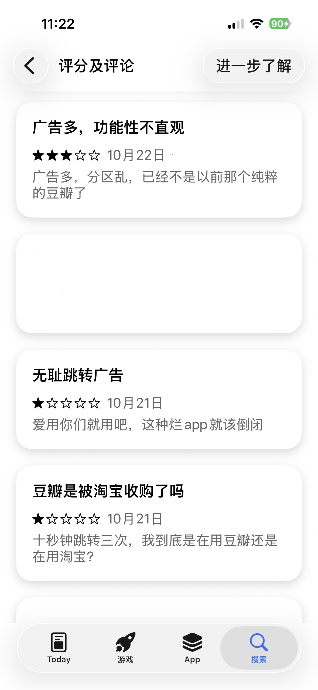
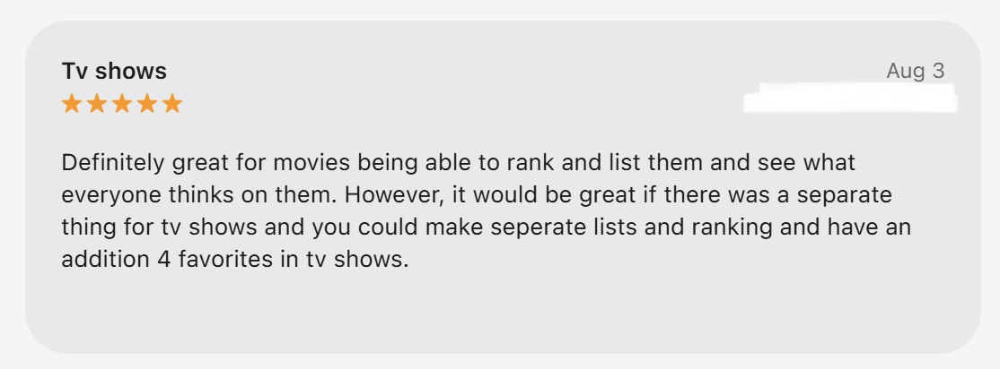
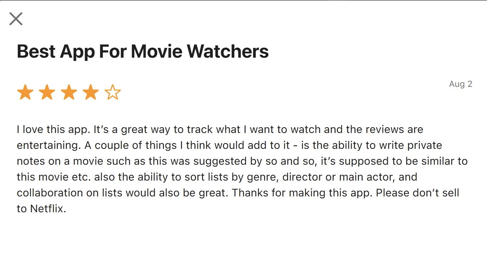
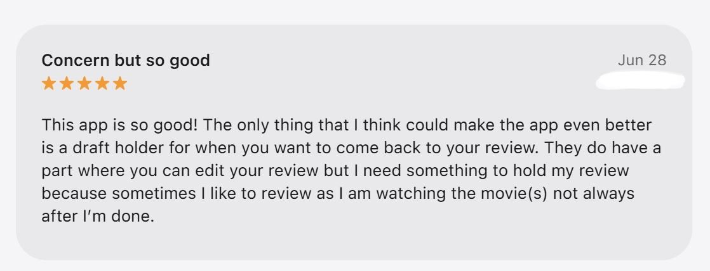
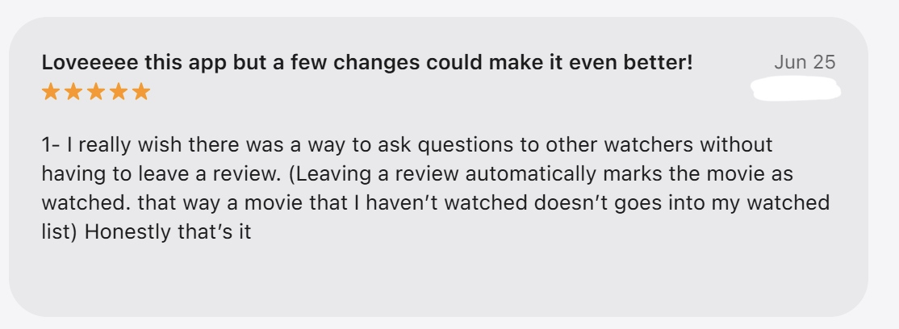
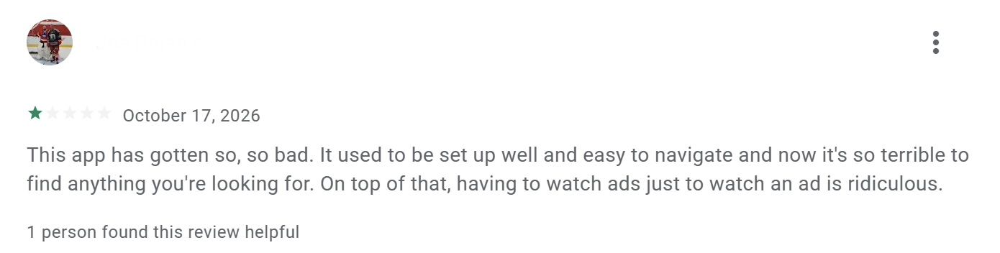
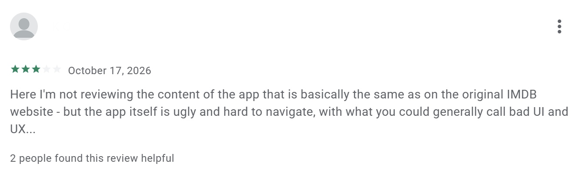
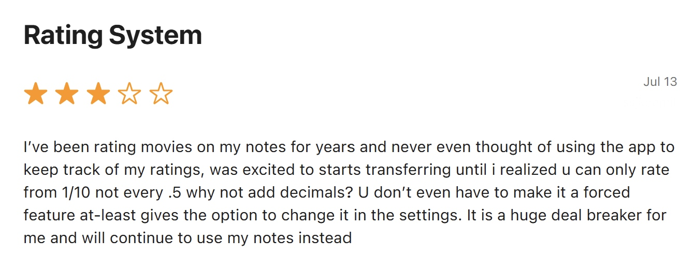
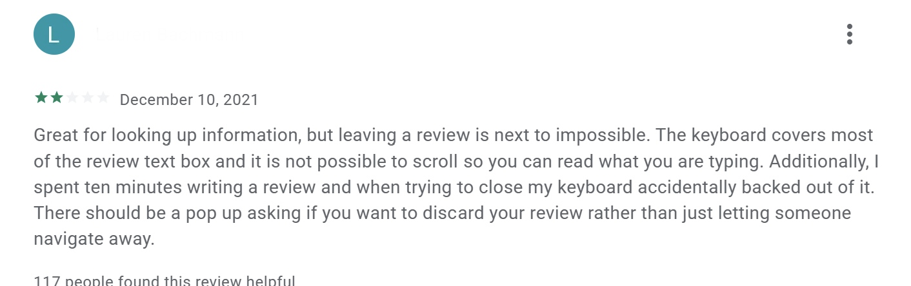
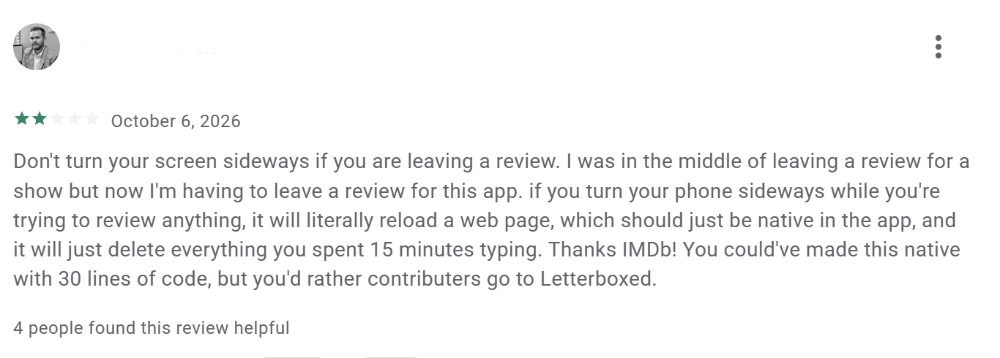

# 1.豆瓣

## 1. 产品信息
| 项目 | 内容 |
| --- | --- |
| 应用名称 | 豆瓣 |
| 开发者 | Beijing Douwang Technology Company Limited |
| App 版本 | 7.137.0 |
| iOS 版本 | 26.6.1 |
| 实测日期 | 2026.11.6 |
| 产品定位 | 集书影音资料、评分评论、个人记录与社区交流于一体的文化生活社区 |

## 2. 页面结构与评分流程

### 2.1 页面结构
共 5 个底部页签：
1. 首页
2. 书影音
3. 小组
4. 市集
5. 我

与观影记录相关的主要页面包括：

| 页面 | 主要作用 |
| --- | --- |
| 首页 | 浏览推荐内容，进入书影音或搜索 |
| 电影列表或榜单 | 查找影片、浏览他人评分与推荐 |
| 影视详情 | 查看作品信息、综合评分和评论，进入标记及评分流程 |
| 评分编辑 | 选择星级、填写评论并提交 |
| 个人书影音记录 | 查看自己标记的作品及相关记录，可查看观影日历 |

其他功能：
* 豆瓣的功能不仅限于影视记录，还覆盖图书、音乐等文化内容，用户可以对相应作品进行标记、评分和评论。
* 社区功能包括豆瓣小组、动态、日记等，用户可以围绕共同兴趣加入小组、发布内容、参与讨论，并通过关注和互动建立联系。
* 市集提供商品浏览和购买入口。

### 2.2 从首页到完成评分路径

首页 → 书影音 → 选择电影 → 看过 → 选择星级 → 提交

预计需要 **5 次点击**。

## 3. app页面截图

| 编号 | 文件名 | 页面 | 展示内容 |
| --- | --- | --- | --- |
| 1 | [douban-home.png](./img/douban-home.png) | 首页 | 完整底部导航及首页 |
| 2 | [douban-list.png](./img/douban-list.png) | 电影列表或榜单 | 条目排列、查找及筛选入口 |
| 3 | [douban-detail.png](./img/douban-detail.png) | 影视详情 | 公众评分、“想看／看过”等操作按钮 |
| 4 | [douban-rating.png](./img/douban-rating.png) | 评分编辑 | 可选星级、短评输入框及标签 |
| 5 | [douban-profile.png](./img/douban-profile.png) | 个人书影音页 | 想看、看过及统计入口 |
| 6 | [douban-edit-rating.png](./img/douban-edit-rating.png)| 已评分条目的编辑页 | 改分入口，以及历史、日期相关选项 |

截图存放位置：`docs/research/img/`

## 4. 记录与评分方式

| 核查项目 | 调研结果 |
| --- | --- | 
| 评分制 | 个人选择 1–5 星，公众综合评分以十分制展示，仅支持整星评分，无半星评分 | 
| 分项评分 | 无剧情、演技、摄影等独立评分字段 |
| 短评 | 支持作品评论；影视页面有短评和影评内容 | 
| 观看日期 | 无法自行设置实际观看日期，仅记录标记日期|
| 按集评分 | 不支持每集分别评分 |
| 修改评分 | 支持通过作品详情或个人记录修改评分 | 
| 改分历史 | 无法查看修改前的历史分数 |
| 重看记录 | 支持为同一影片保留多次观看日期及各次独立评分 |

## 5. 不足

### 5.1 评分粒度较粗

**使用场景：** 用户认为一部影片介于“还行”和“推荐”之间，希望表达更细微的评价。

**问题：** 若仅支持整星档位，用户只能在相邻星级之间选择，难以准确表达中间态度。

**证据：**
公开评分机制描述为个人选择 1–5 星。

### 5.2 评分维度和观影记录方式较为有限

**使用场景：** 用户希望分别评价影片的剧情、演技和摄影，记录电视剧不同集数的表现；补录过去看过的作品时，希望填写实际观看日期。

**问题：** 以作品整体评分和单次标记为主，无法充分满足更细致的记录需求：

- 不支持剧情、演技、摄影等分项评分，难以体现作品不同方面的优缺点。
- 不支持电视剧分集评分，难以记录不同集数之间的质量差异。
- 无法自行设置实际观看日期，补录时的标记日期不能准确反映真实观影时间。
- 修改评分后无法查看旧分数，不便追溯个人评价的变化。

**证据：** 见 和 展示界面。

### 5.3 开屏广告与复杂页面影响使用体验

**使用场景：** 用户希望打开应用后快速查找影片、完成评分或查看个人观影记录。

**问题：** 开屏广告打断了进入应用的流程，增加了快速记录前的等待或跳过操作。
同时，应用整合了推荐内容、书影音、小组、市集等多种功能，页面信息较多。对于主要使用观影记录功能的用户，定位目标入口需要额外的浏览和判断，影响操作效率。

**证据：** 
* 根据本次使用观察，启动过程中出现开屏广告，首页也包含多类内容入口。     
* 应用商店中多名用户反馈广告过多

## 6. 目标用户

豆瓣最适合希望参考中文口碑选片、记录书影音体验，并参与评论交流的用户。

# 2.Letterboxd
## 1. 产品信息

| 项目 | 内容 |
| --- | --- |
| 应用名称 | Letterboxd |
| 开发者 | Letterboxd Ltd |
| App 版本 | 4.13.6 |
| iOS 版本 | 26.6.1|
| 实测日期 |  2026.11.6 |
| 产品定位 | 以电影为核心，集观影日记、评分评论、片单管理与影迷交流于一体的记录和社交平台 |

## 2. 页面结构与评分流程

### 2.1 页面结构

共 5 个底部标签：

1. 首页／热门（Popular）
2. 搜索（Search）
3. 添加观影记录（中央“＋”按钮）
4. 动态（Activity）
5. 个人主页（Profile）

与观影记录相关的主要页面包括：

| 页面 | 主要作用 |
| --- | --- |
| 首页／热门 | 浏览热门影片、影评、片单及好友相关内容 |
| 搜索与电影列表 | 查找影片、用户和片单，浏览并筛选作品 |
| 电影详情 | 查看影片资料、公众评分、评论，以及自己的观看和收藏状态 |
| 评分与观影记录编辑 | 选择星级、填写评论、设置观看日期，并添加重看标记和标签 |
| 个人主页 | 查看已看影片、观影日记、评论、待看片单及个人片单 |
| 统计页面 | 查看年度和累计观影统计，完整个性化统计属于付费功能 |

其他功能：Letterboxd 支持创建和分享主题片单、维护待看片单（Watchlist），也支持关注其他用户、浏览好友动态，以及对影评和片单进行互动。用户可以通过标签整理观影记录，并使用喜欢（Like）标记表达对影片的喜爱。平台还提供电影专题和编辑内容，整体围绕电影发现、记录与交流展开。

### 2.2 从首页到完成评分路径

路径：

首页 → 点击+号 → 搜索/选择电影→选择星级/影评 → 保存

预计需要 **4次点击**

## 3. App 页面截图

| 编号 | 文件名 | 页面 | 展示内容 |
| --- | --- | --- | --- |
| 1 | [letterboxd-home.png](./img/letterboxd-home.png) | 首页 | 完整底部导航、热门影片推荐页 |
| 2 | [letterboxd-list.png](./img/letterboxd-list.png) | 电影列表或片单 | 条目排列、筛选入口 |
| 3 | [letterboxd-detail.png](./img/letterboxd-detail.png) | 电影详情 | 公众评分、电影简介 |
| 4 | [letterboxd-rating.png](./img/letterboxd-rating.png) & [letterboxd-history.png](./img/letterboxd-history.png) | 评分与记录编辑 | 半星评分、评论、观看日期及评论更改记录 |
| 5 | [letterboxd-profile.png](./img/letterboxd-profile.png) | 个人主页 | 已看影片、观影日记、片单及总评分数 |
| 6 | [letterboxd-diary.png](./img/letterboxd-diary.png) | 观影日记 | 观看日期、同一影片的多次记录及各次评分 |

截图存放位置：`docs/research/img/`

## 4. 记录与评分方式

| 核查项目 | 调研结果 |
| --- | --- |
| 评分制 | 采用五星制，支持半星，评分范围为 0.5–5 星；公众平均评分也以五星尺度展示 |
| 分项评分 | 标准评分流程以作品整体评分为主，无剧情、演技、摄影等独立评分字段 |
| 短评 | 支持在观影记录中填写评论，也可记录后补写或编辑评论，可选是否含spoiler |
| 观看日期 | 支持通过观影记录设置具体观看日期；仅标记“看过”不会自动建立带日期的日记记录 |
| 按集评分 | 不提供完整的电视剧逐集追踪与评分体系 |
| 修改评分 | 支持修改影片评分，也可编辑已有观影日记或评论中的评分 |
| 改分历史 | 不同观影记录可以保留不同评分，但不保留同一条记录每次修改前的分数 |
| 重看记录 | 支持对同一影片多次添加观影记录，保存不同观看日期，并为不同记录填写独立评分和评论 |

需要特别区分两种情况：

- **新增一次重看记录：** 之前记录中的评分不会因此被覆盖，可用于比较不同观看时的感受。
- **编辑原有记录的评分：** 属于修改已有内容，不能据此认为系统会保留修改前的版本。

参考资料：

- [Letterboxd 官方帮助中心](https://letterboxd.com/faq/)
- [官方说明：标记看过与添加观影记录的区别](https://letterboxd.zendesk.com/hc/en-us/articles/15178778774543-What-s-the-difference-between-marking-a-film-watched-and-logging-it)
- [官方说明：修改评分是否影响其他记录](https://letterboxd.zendesk.com/hc/en-us/articles/15178802067855-When-I-rate-a-film-do-all-my-ratings-for-it-change)

## 5. 不足

### 5.1 电视剧记录与分集评分能力有限

**使用场景：** 用户既看电影，也长期追看电视剧，希望在同一个应用中记录观看进度，并分别评价每一集。

**问题：** Letterboxd 以电影为核心，电视内容的支持范围有限，难以满足完整的剧集、季和单集管理需求。部分迷你剧、电视电影或特殊单集虽然有独立条目，但不能替代普遍的逐集追踪与评分功能。用户可能需要额外使用其他追剧工具，导致观影记录分散。

**证据：** 
* 官方帮助说明列出了有限的电视内容支持范围，包括部分迷你剧、电视电影，以及《黑镜》等特殊单集。[Letterboxd 官方电视剧支持说明](https://letterboxd.zendesk.com/hc/en-us/articles/15269096507407-Do-you-support-TV-shows)

* App Store 用户表示希望能够为电视剧单独创建列表、进行评分与排名，并在个人主页展示最喜爱的电视剧，以满足电影与电视剧分类管理及个性化展示的需求。

### 5.2 导演关注与作品批量整理不够便捷

**使用场景：** 用户喜欢某位导演，希望持续关注其作品，并将该导演执导的电影统一加入个人片单，制定补片计划。

**问题：** 根据本次使用观察，未找到直接关注导演的入口，也未在所测试的导演作品页中找到将全部作品一次性加入片单的操作。用户需要逐部选择和添加影片；当导演作品较多时，操作重复，也容易遗漏。

关注导演与批量整理作品是两项不同需求：前者用于持续追踪，后者用于快速建立片单。若能分别提供相应入口，可以减少手动维护的负担。

**证据：** App Store用户表示希望支持按照电影类型、导演或主演对片单进行排序；同时增加多人协作编辑片单的功能，以提升个人观影管理的灵活性和社交互动体验。

### 5.3 影评缺少草稿保存功能

**使用场景：** 用户在观看电影的过程中产生想法，希望随时记录观影感受，并在电影结束后继续完善影评。

**问题：** Letterboxd 虽然支持编辑已发布的影评，但缺少独立的草稿保存功能。用户无法方便地保存尚未完成的影评并在之后继续编辑，限制了观影过程中的即时记录需求。

**证据：** App Store 用户 表示，希望应用提供影评草稿功能，以便在观看电影时记录想法，而不必等到电影结束后再撰写。

### 5.4 提问功能与观影记录状态绑定

**使用场景：** 用户在观看某部电影之前，希望向其他观众询问影片相关问题，例如电影内容、观看建议或观影体验，但尚未实际观看该影片。

**问题：** 缺少独立于影评的提问入口。用户若通过发表影评的方式参与讨论，可能导致尚未观看的电影被标记为“看过”，影响个人观影记录的准确性。用户希望能够在不改变观看状态的情况下与其他观众交流。

**证据：** App Store 用户表示，希望能够不通过发表影评就向其他观众提问，因为发表影评会自动将电影标记为已观看。

## 6. 目标用户
Letterboxd 最适合以电影为主要兴趣，希望记录观看日期与重看感受、整理片单，并与其他影迷交流的用户。

# 3.IMDb
## 1. 产品信息

| 项目 | 内容 |
| --- | --- |
| 应用名称 | IMDb Movies & TV |
| 开发者 | IMDb.com, Inc. |
| App 版本 | 17.1 |
| iOS 版本 | 26.6.1 |
| 实测日期 |  2026.11.6 |
| 产品定位 | 以电影、电视剧及演职人员资料为核心，提供评分评论、待看管理、观看记录和影视资讯的综合平台 |

## 2. 页面结构与评分流程

### 2.1 页面结构

共 3 个底部页签：

1. 首页（Home）
2. 搜索（Search）
3. 个人（You）

与观影记录相关的主要页面包括：

| 页面 | 主要作用 |
| --- | --- |
| 首页 | 浏览影片推荐、预告片、榜单及影视资讯 |
| 搜索与列表 | 查找电影、电视剧及影人，浏览相关作品 |
| 影视详情 | 查看作品信息、公众评分、演职人员和用户评论 |
| 分季及单集页面 | 浏览电视剧各季、各集的信息，并进入单集详情和评分 |
| 评分界面 | 选择个人评分并提交，可选是否含spoiler |
| 个人页面 | 查看个人评分、待看片单、自建列表及观看历史 |
| 观看历史 | 查看被系统记录为已经看过的作品 |

其他功能：IMDb 提供较丰富的演职人员资料、作品履历、预告片、访谈、影视新闻和奖项信息。

参考资料：[IMDb 官方 iOS 功能说明](https://help.imdb.com/article/imdb/mobile-web-apps/ios-app-faq/GJ7P484D8FA9C48Q)

### 2.2 从首页到完成评分路径

评分路径：

首页 → 选择影片 → 点击评分入口（Rate）→ 选择分数 → 提交

预计需要 **4 次点击**。

如果目标作品是电视剧中的某一集，还需要进入剧集列表并选择对应单集，操作次数应另行记录。

参考资料：[IMDb 官方评分操作说明](https://origin-help.imdb.com/article/imdb/track-movies-tv/how-do-i-submit-my-rating-on-imdb/G9R8NF943K39DQDT)

## 3. App 页面截图

| 编号 | 文件名 | 页面 | 展示内容|
| --- | --- | --- | --- |
| 1 |  [imdb-home.png](./img/imdb-home.png) | 首页 | 完整底部导航、推荐内容及搜索入口 |
| 2 |  [imdb-list.png](./img/imdb-list.png) | 电影列表 | 条目排列、待看片单 |
| 3 | [imdb-detail.png](./img/imdb-detail.png) | 影视详情 | 公众评分与评论、个人评分、待看及看过操作 |
| 4 | [imdb-rating.png](./img/imdb-rating.png) | 评分界面 | 1–10 分选项及评论输入界面 |
| 5 | [imdb-profile.png](./img/imdb-profile.png)| 个人页面 | 个人评分、列表及观看历史入口 |
| 6 | [imdb-episode.png](./img/imdb-episode.png) | 电视剧单集详情 | 季集信息、单集公众评分及个人评分入口 |

截图存放位置：`docs/research/img/`

## 4. 记录与评分方式

| 核查项目 | 调研结果 |
| --- | --- |
| 评分制 | 个人采用 1–10 分的整数评分；公众综合评分以十分制展示，并采用加权计算 |
| 分项评分 | 官方标准评分针对作品整体；不支持到剧情、演技、摄影等独立评分字段 |
| 短评 | 支持用户影评，但存在最低长度要求（至少300个字符） |
| 观看日期 | 不支持自定义实际观看日期 |
| 按集评分 | 支持对电视剧单集评分；单集评分与整部剧集的评分分别计算 |
| 修改评分 | 支持修改或删除个人评分；新评分会替换原评分 |
| 改分历史 | 不支持修改前后版本的查询功能 |
| 重看记录 | 不支持多次观看日记及每次独立评分功能 |
| 标记看过 | 支持单独标记已看；对作品评分、发表评论或进行 Check-in，也会将作品计为已看 |

参考资料：

- [IMDb 官方评分说明](https://help.imdb.com/article/imdb/featured-content/ratings-faq/G67Y87TFYYP6TWAV)
- [官方修改或删除评分说明](https://origin-help.imdb.com/article/imdb/track-movies-tv/how-do-i-change-or-delete-my-rating-on-a-title/GD9UAYG9EUUERMUH)
- [官方用户影评规则](https://help.imdb.com/article/contribution/contribution-information/user-review-guidelines/GABTWSNLDNFLPRRH)
- [官方标记看过与观看历史说明](https://help.imdb.com/article/imdb/new-features-updates/mark-as-watched-faq/GR2SD7Y4LZVNHUVH)
- [官方列表说明及导出方法](https://help.imdb.com/article/imdb/track-movies-tv/lists-faq/GNQMN47VZSE7KW38)

## 5. 不足

### 5.1 影评最低长度限制不利于快速记录感想

**使用场景：** 用户看完一部电影或电视剧单集，只想记录一句简短感受，例如喜欢某个角色的表现，或对结局作简短评价。

**问题：** 用户影评存在最低长度要求，短于门槛的内容无法按普通影评提交。对于只希望快速留下几句话的用户，需要扩写内容，或改用其他记录方式，增加了表达负担。

**证据：** 当前官方影评规则要求至少 300 个字符。

参考资料：[IMDb 官方用户影评规则](https://help.imdb.com/article/contribution/contribution-information/user-review-guidelines/GABTWSNLDNFLPRRH)

### 5.2 界面导航不够直观，影响信息查找效率

**使用场景：** 用户打开 IMDb，希望快速查找电影、电视剧或演员的相关信息，需要通过首页、导航菜单及不同内容页面定位目标。

**问题：** 根据用户反馈，IMDb 的移动端界面布局和导航设计不够直观，用户难以快速找到所需内容。部分长期用户认为，软件更新后原本便捷的导航体验有所下降，增加了信息查找的操作成本。此外，广告展示也可能进一步干扰正常浏览。

**证据：**

- Google Play 用户表示，IMDb 过去的界面布局清晰、易于导航，但现在查找所需内容变得困难。此外，用户还抱怨广告观看体验不合理。
- Google Play 用户表示，虽然 IMDb App 的内容与网页版基本一致，但移动端界面不够美观、导航困难，整体 UI 和 UX 体验不佳。

### 5.3 评分精度有限，缺少灵活的评分设置

**使用场景：** 用户习惯使用带小数的评分记录电影，例如 7.5/10，希望将过去的个人评分迁移到 IMDb，统一管理观影记录。

**问题：** IMDb 的个人评分采用 1–10 的整数评分体系，不支持直接输入小数评分，也缺少切换评分精度的设置。对于习惯使用半分或小数评分的用户，现有评分方式难以准确表达个人评价，可能降低其迁移和持续使用的意愿。

**证据：** App Store 用户表示，原本希望将备忘录中的电影评分迁移至 IMDb，但发现无法使用 0.5 分的评分间隔，因此决定继续使用备忘录。

### 5.4 影评编辑交互不完善，缺少内容保护机制

**使用场景：** 用户在撰写较长的电影或电视剧影评时，需要持续输入、查看和修改文字。在编辑过程中，用户可能需要关闭键盘、调整屏幕方向或进行其他操作。

**问题：** 影评编辑界面存在键盘遮挡输入区域、页面无法正常滚动等交互问题，影响长篇影评的撰写。此外，误退出编辑页面或旋转屏幕可能导致页面重新加载，使尚未提交的内容丢失。缺少有效的草稿保存或退出确认机制，增加用户重复输入的负担。

**证据：**

- Google Play 用户表示，键盘遮挡了大部分影评输入框，且无法滚动查看正在输入的文字。用户还曾因尝试关闭键盘而误退出编辑页面，导致花费约10分钟撰写的内容丢失，并建议增加退出确认提示。
- Google Play 用户表示，在撰写电视剧影评时旋转手机，导致页面重新加载，约15分钟的输入内容全部丢失。

## 6. 目标用户
IMDb 最适合希望查询丰富影视与演职人员资料、参考公众口碑，并同时评价电影和电视剧单集的用户。